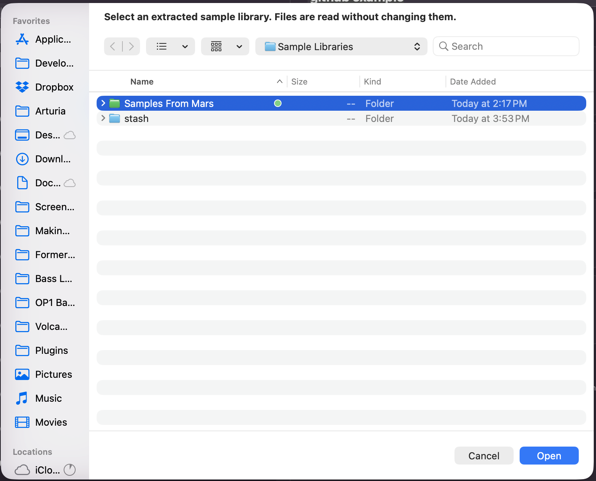
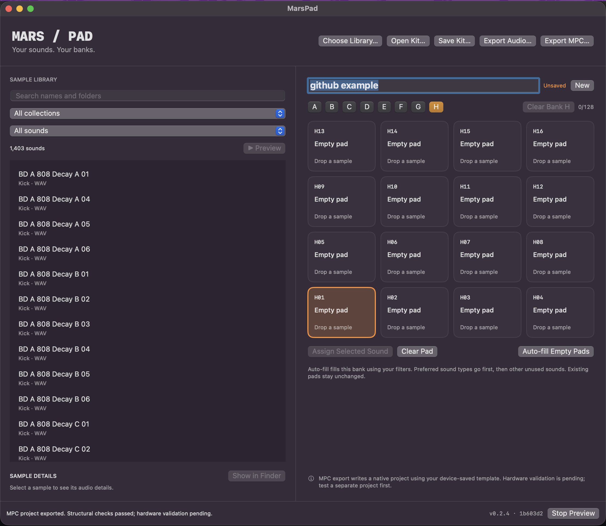
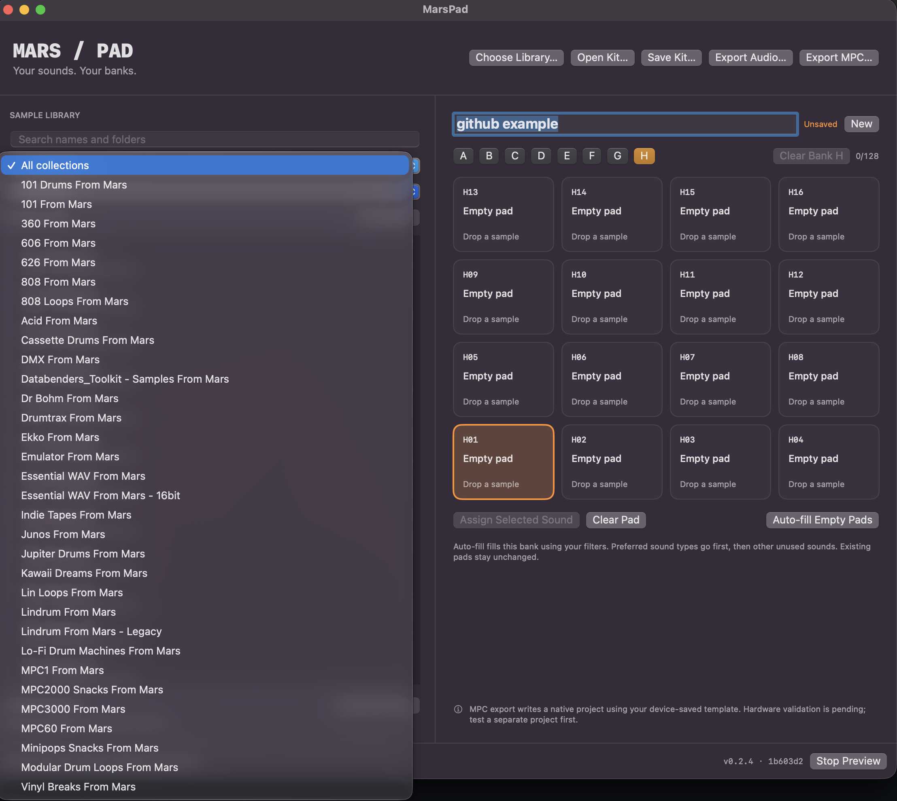
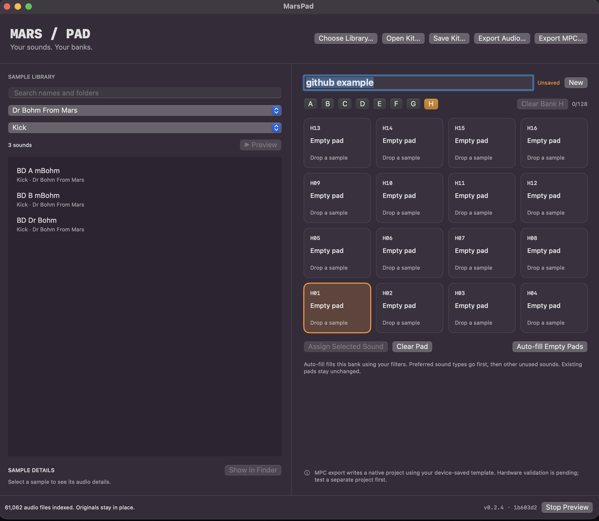

# MarsPad

A local macOS sample librarian and pad-bank planner for Akai MPC Sample owners.
MIT licensed. Unaffiliated with Akai Professional or Samples from Mars.

## Current release: 0.3.0 prototype

- Scan extracted audio collections without modifying source files. ZIPs are skipped.
- Search by filename or folder, filter collections and inferred sound categories.
- Audition audio using asynchronous macOS playback; selecting a sound immediately
  detaches the previous preview without waiting for a full-file decode. Format
  support depends on macOS.
- Assign samples to 16 pads across banks A–H by dragging or using Assign Selected Sound.
- Auto-fill empty pads in the current bank using the current library filters.
- Save/open editable `.marspad` kit plans. These reference original absolute paths.
- Export unchanged sample copies and a CSV pad map into a fresh output folder.
- Export a native `.xpj` plus companion audio directory using a device-saved template.

Native export is experimental. **A previous generated project failed to load on
the hardware.** Version 0.2.4 preserves native serialization order and scalar
formatting. A user subsequently confirmed a successful three-sample load with
correct assignments at A01, A02 and A11, full playback, and a device save/reload
round trip. Subsequent user testing confirmed bank order across A–H, including
A16 → B01 and H16. This supports the tested workflow on that unit, rather than
establishing compatibility for every project or firmware version.
Audio-only export remains available for manual assignment. The app writes new
folders, never firmware or device system files.

## Keyboard controls

Click the sample list or a pad to use these keys. Shortcuts are inactive while
editing text or using a file dialog; normal typing, text-cursor arrows, and
Command-key shortcuts are preserved.

| Key | Action |
| --- | --- |
| W / S | Previous / next sample in the filtered library (auditions on selection) |
| D | Play the selected library sound, even if it is not assigned to a pad |
| A | Stop playback |
| Arrow keys | Move through the selected bank's 4 × 4 pad grid |
| 1–8 | Select banks A–H, keeping the same pad position |
| Space | Assign the selected library sound to the selected pad |
| C | Clear the selected pad |

Pad movement stops at the grid edges. Up moves toward pads 13–16; Down moves
toward pads 1–4. W/S keeps the library selection visible as you browse.

## Inclusion and exclusion filters

Choose a collection and sound type as before. Use **Exclude sounds…** to remove
one or more types—for example, **Kick** and **Loops**—while leaving All sounds
selected. Exclusions apply to browsing and auto-fill, and never change pads you
have already assigned. A kick loop matches both Kick and Loops, so either
exclusion removes it. Clear exclusions through the same menu.

Search supports negative terms and quoted phrases:

- `-kick -loops`: omit kicks and loops.
- `808 -loops`: find matching 808 sounds while omitting loops.
- `"No Accent"`: find samples whose documented accent code means No Accent.

These filters work together. A Musical key menu appears when filenames contain
explicit major/minor keys, such as `F#m` or `Dmaj`; this is filename metadata,
not audio key detection. Existing saved kit plans remain readable.

## Samples from Mars information files

Scanning also reads local RTF information/reference documents (up to 2 MB each),
skipping installation and coupon documents. Source files remain unchanged and
no pack documentation is bundled with the app or repository.

- Reference entries are matched by exact sample filename; matching chord
  progression text becomes searchable and appears in the sample details.
- When a collection documents all three A/B/C accent codes, those meanings are
  expanded for the filename's second-token accent code. The original code and
  sample name remain unchanged. Ambiguous or undocumented codes are not guessed.
- **Search collection notes** optionally includes general pack descriptions in
  searches. These are pack-level matches, not properties asserted for every sound.
- **Collection Info…** opens the original document of your choice for reference.

For best coverage, select the extracted library root or an entire pack (including
its Docs folder), rather than only its WAV subfolder. Rescan with Choose Library
if the documents or extracted samples change.

## Getting started in pictures

The sample collections shown below are supplied by the user and are not bundled
with MarsPad.

### 1. Choose your sample library



*Click **Choose Library…** and select the folder containing your extracted samples.
MarsPad indexes the audio without changing the original files. For responsive
previewing, choose a locally downloaded library rather than cloud-only files.*

### 2. Browse your sounds



*Use **All collections** and **All sounds** to browse the selected library. The
sample list is on the left; the selected bank's 16 pads are on the right.*

### 3. Narrow the collection



*Open the collection menu to focus on one pack or instrument collection, or keep
**All collections** selected to browse across the library.*

### 4. Filter by sound type



*Combine collection and sound-type filters to narrow your choices—for example,
**Kick** sounds from **Dr Bohm From Mars**. These filters also determine which
sounds **Auto-fill Empty Pads** can choose.*

## Note to self: screenshots to capture someday

Documentation reminders for a future session. Use one consistently named demo
kit throughout; these captures are optional follow-up work.

- [ ] **Preview and details:** select a sample with duration, bit rate, and Show in Finder visible.
- [ ] **Manual assignment:** show a named sound assigned to A01.
- [ ] **Auto-fill:** show a populated bank with the active filters visible.
- [ ] **Bank switching:** capture the same kit in banks A and B with different assignments.
- [ ] **Clear Bank:** capture before and after clearing one bank.
- [ ] **Save/Open Kit:** show saving a `.marspad` file and reopening it with assignments restored.
- [ ] **Export template selection:** show selecting a project saved by the MPC Sample.
- [ ] **Exported files:** show the kit-named `.xpj` beside its matching audio folder.
- [ ] **SD placement:** show both items directly inside `MPC-Sample/Projects`.
- [ ] **Hardware result:** photograph the matching assignments on the MPC Sample.

See the [screenshot capture checklist](docs/SCREENSHOT-CHECKLIST.md) for more detail.

## Export to MPC Sample

1. Save your kit plan, then choose **Export MPC…**.
2. On first export, select a project saved by your MPC Sample: an `.xpj` or a ZIP
   containing one. A template with at least one empty pad is required. This
   release accepts only AC50 / engine Sample / schema 28 / preamble 1.3.0.12.
   The supplied template stays unchanged and is not bundled in the source code.
3. Choose a local destination. For a kit named `My Kit`, the app writes a fresh
   `My Kit` folder with `My Kit.xpj`, `My Kit_[ProjectData]/`, a report, and notes.
   Existing exports remain intact: repeated exports use `My Kit-2`, `My Kit-3`,
   and so on. Unsupported filename characters are replaced and long names limited.
4. Copy the `.xpj` and its matching `_[ProjectData]` folder directly into
   `MPC-Sample/Projects` on your microSD card, matching device-created projects.
   Do not copy the outer export folder. Leave `MPC-Sample/Samples` unchanged.
   Keep reports locally, and avoid replacing existing device projects. Safely
   eject the card before leaving SD Card Access mode.
5. Save your current MPC project, load the exported `.xpj` via the Project menu,
   and verify bank boundaries, full sample playback, and empty pads. This is the
   remaining hardware validation step; software checks cannot establish it.

The template path is remembered. Right-click Export MPC… and choose Change MPC
Template… to select another reference. Export snapshots the kit so subsequent
edits do not change an in-progress export.

Audio is streamed into 24-bit PCM WAVs, retaining source rate and channels.
Mono/stereo at 44.1, 48, or 96 kHz and up to 20 minutes per sample are supported;
other rates/channels or unreadable files fail with the affected pad identified.
Sources are not normalized or changed. Export uses the template's empty-pad
settings for every instrument, sets each sample's full inclusive end frame,
clears old sample references, sequence events, song items and effects, and retains
routing and other unknown schema defaults. It creates a clean kit, not a copy of
the template's music. Other retained device/controller defaults still need a
hardware check. Partial exports are removed on failure.

## Build and run

Requires macOS 13+ and Apple Command Line Tools / Xcode with Swift 5.9+.

```sh
./build-app.sh
open "dist/MarsPad $(cat VERSION).app"
```

The build is locally ad-hoc signed; public distribution would require release
packaging, signing and notarization. Run `swift test` for model checks.
If XCTest is unavailable in Command Line Tools, run `swift run MarsPad --self-test`
for the built-in model checks. `swift run MarsPad --preview-self-test` exercises
rapid switching with generated silent audio, including a three-minute file.
The model checks also cover keyboard mappings, text-entry guards, grid boundaries,
legacy kit plans, exclusions and synthetic RTF reference/legend parsing.
Only the development Mac architecture is built by default. Windows/Linux are
future work; the SwiftUI interface would need replacement or a separate frontend.

Choose Library and select your extracted Samples from Mars folder. Select a sound
to preview it, select a pad, then Assign Selected Sound, or drag it onto a pad.
Auto-fill first places preferred categories, then fills remaining empty pads with other
unused sounds matching the current filters. It keeps occupied pads and avoids
reusing files assigned anywhere in the kit. If too few eligible sounds remain,
the status explains why some pads are empty. Category
inference favors filename tokens and nearby sound folders; ambiguous names appear
under Other. Explicit filename sound types are not overridden by unrelated
ancestor-folder names.
Clear a pad using its context menu. Clear Bank A–H removes every assignment in
the selected bank while keeping the other banks unchanged. Save Kit before quitting; there is no autosave.
Saved kits are machine-local plans; moving sample folders breaks their references.

## Native format investigation

`python3 tools/inspect_project.py /path/to/project.zip` performs a read-only archive
integrity and sample-reference check, printing inferred assignments. It does not
extract files, execute project content, or generate device projects.
`python3 tools/test_native_export.py /path/to/MarsPad /path/to/reference.zip`
checks native exports using generated audio and your read-only reference.
It covers all banks, sparse assignments, PCM payloads, sample lengths, missing
files, invalid templates, unsupported rates, and cleanup. No proprietary fixture
is committed. See COMPATIBILITY.md for evidence and limits.

## Repository boundaries

Commit code and documentation only. Do not commit commercial audio, personal
MPC projects, exported kits, local library indexes or absolute personal paths.
No audio or supplied project is bundled with this repository. MIT applies to this
application's code; it does not relicense any imported sample content.

## Audio details and build identity

Select a library sound or populated pad to see duration, bit rate, PCM bit depth,
sample rate and channel count beneath the library. **Show in Finder** reveals that
file, including when metadata or preview fails. Its path is displayed and can be
copied. Stopping playback keeps the inspected file available. Metadata failures
show the underlying error; metadata and playback use separate readers, so a
metadata failure alone does not establish that the audio cannot play or export. Header reads happen in the
background; stale selections cannot overwrite the current details. Compressed
durations are marked approximate, and unavailable properties are labeled. Bit
rate is audio data per second (kb/s); bit depth is shown separately for PCM.

The footer shows the version from VERSION and the Git commit embedded when
packaged. Builds from modified source have a `-dirty` suffix. Direct `swift run`
launches show development/unpackaged rather than claiming a release identity.
An existing binary can be packaged with `./build-app.sh /absolute/path/to/MarsPad`;
use a binary built from the current checkout so the embedded identity is accurate.

Native exports preserve original sample names in pad layers and sample inventories.
WAV filenames use `A01_original-name.wav` with filesystem-safe characters and a
length limit. If sample names repeat (including case variants), pad suffixes such
as `Kick [A01]` keep native sample identities distinct. Original names are always
retained in the export report. Hardware display behavior remains unvalidated.
